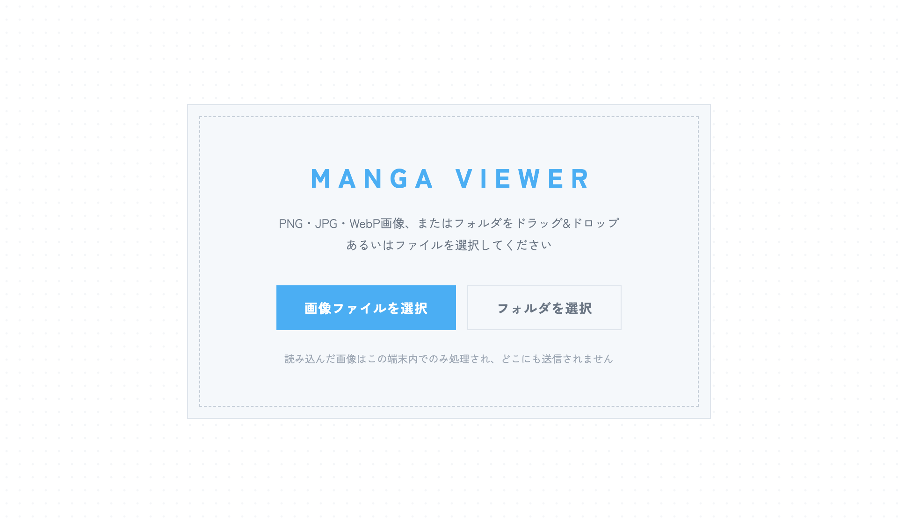

# マンガビューワー

手元のマンガ画像を、PCのブラウザで見開き表示して読むためのビューワーです。
`index.html` 1つで動くので、インストールは要りません。

## 使い方

1. **[ビューワーを開く](https://tsugunagato.github.io/manga-viewer/)**（PCのブラウザで）
2. 画像ファイルかフォルダを選択、または画面にドラッグ&ドロップします。

`index.html` をダウンロードして、手元のブラウザ（Chrome / Edge / Safari / Firefox）で直接開いても使えます！

## 主な機能

- **右綴じの見開き表示**：右から左へ読み進めます。横長の画像は見開きページとして中央に1枚で表示します。
- **開始位置の切り替え**：「開始:左／右」ボタンで、見開きのページの組み合わせを1ページずらせます。
- **フォルダごとの読み込み**：PNG / JPG / WebP に対応しています。サブフォルダの画像もまとめて読み込み、ファイル名の番号順（`2` の次が `10`）に並べます。
- **ページ一覧**：サムネイルをクリックすると、そのページへ移動します。
- **進捗バー**：クリックした位置のページへ移動します。
- **全画面表示**

## 操作方法

右綴じなので、左へ進んで右へ戻ります。

| 操作 | 動作 |
|---|---|
| `←` / `A` キー、画面の左半分をクリック | 次のページ |
| `→` / `D` キー、画面の右半分をクリック | 前のページ |
| マウスホイールを下 / 上 | 次 / 前のページ |
| `Home` / `End` | 最初 / 最後のページ |
| `Esc` | ページ一覧を閉じる |

## プライバシー

読み込んだ画像は端末の中だけで処理し、外部には送信しません。
外部に接続するのは、画面表示用のフォントを Google Fonts から取得するときだけです。

## ライセンス

[MIT](LICENSE)
